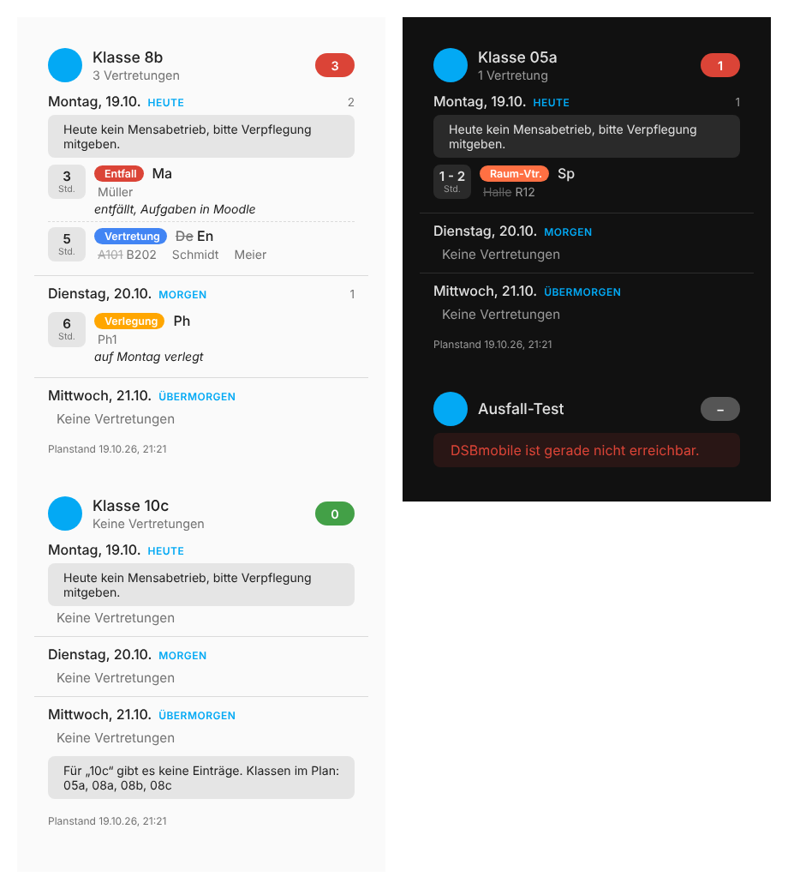

# DSB Vertretungsplan for Home Assistant

Custom integration that brings the Untis substitution plan ("Vertretungsplan") published through **DSBmobile** into Home Assistant. The plan is loaded **once per school account**; filtering by class happens on the dashboard or in automations. One account and one sensor are enough for several children at the same school.

- **Mobile API, no web scraping.** Uses the same token based API as the DSBmobile app (`mobileapi.dsbcontrol.de`). No ASP.NET login form, no flapping between real data and "no substitutions".
- **DataUpdateCoordinator with proper error handling.** Connection problems are reported as `UpdateFailed`, the last good data is kept and entities become `unavailable` instead of silently dropping to 0. An empty plan (holidays) is a valid state.
- **Re-auth, reconfigure, options without restart, diagnostics export, translations (de/en).**
- **Bundled dashboard card** with a visual editor, served by the integration itself.
- **Robust Untis parser.** Columns are detected by their header, `<s>old</s> new` and `old?new` are recognised as changes, merged classes such as `08abc` are expanded to `08a, 08b, 08c`, several days per file are supported.

## Installation

**HACS:** three dots → Custom repositories → URL of this repository, category *Integration* → install → restart Home Assistant.

**Manual:** copy the folder `custom_components/dsb_vertretungsplan` to `<config>/custom_components/` and restart.

## Setup

**Settings → Devices & services → Add integration → "DSB Vertretungsplan"**, enter the user ID and password as used in the DSBmobile app. Under **Configure** you can change later:

| Option           | Default | Meaning                                                     |
|------------------|---------|-------------------------------------------------------------|
| Preview in days  | 3       | The sensor contains entries from today up to N days ahead   |
| Polling interval | 30 min  | How often DSB is queried (minimum 5 min)                    |

## Entities

All entities belong to the device "DSBmobile *user ID*". Entity IDs below are the German ones; with an English Home Assistant UI the suffixes are translated (`substitution_plan`, `plan_updated`, ...).

| Entity                                    | State                                    | Attributes                                                   |
|-------------------------------------------|------------------------------------------|--------------------------------------------------------------|
| `sensor.dsbmobile_<id>_vertretungsplan`   | number of entries (all classes, N days)  | `days` (per day: `date`, `day_label`, `count`, `info`), `classes` (all classes that have entries), `plan_days`, `plan_updated`, `from`, `to`, `days_ahead` |
| `calendar.dsbmobile_<id>_vertretungsplan` | next entry as an all-day event           | for the calendar card and calendar triggers                  |
| `sensor.dsbmobile_<id>_planstand`         | time the plan was last published         |                                                              |
| `sensor.dsbmobile_<id>_nachrichten`       | number of news items                     | `news`                                                       |
| `sensor.dsbmobile_<id>_dokumente`         | number of documents                      | `documents`                                                  |
| `sensor.dsbmobile_<id>_plane`             | number of plans (diagnostic)             | `plans`, `plan_days`, `errors`                               |
| `sensor.dsbmobile_<id>_letzte_abfrage`    | last successful poll (diagnostic)        |                                                              |

`days` contains **every plan day inside the window**, including days without entries (`count: 0`). The entries themselves are deliberately not exposed as attributes: the plan of a whole school quickly exceeds the 16 kB Home Assistant allows for state attributes. The card fetches entries through the websocket command `dsb_vertretungsplan/entries`, automations through the action `dsb_vertretungsplan.get_entries` (see below). An entry looks like this:

```yaml
date: "2026-10-19"
day_label: "19.10.2026 Montag"
type: "Vertretung"              # Untis column "Art"
classes: "08abc"                # column "Klasse(n)" as delivered by Untis
class_list: ["08a", "08b", "08c"]   # expanded and normalised
lesson: "5"
subject: "En"
room: "B202"
substitute: "Schmidt"           # "Vertr. von" / "Vertreter"
teacher: "Meier"                # "(Le.) nach" / "Lehrer"
text: ""
changes: { subject: "De", room: "A101" }   # previous values of changed fields
columns: { "Art": "Vertretung", "(Fach)": "De → En", ... }   # every column, raw
```

## Dashboard card per child

The integration ships its own Lovelace card and registers it automatically as a dashboard resource (visible under Settings → Dashboards → Resources, do not remove it); no manual resource entry and no second HACS repository are needed. If your resources are managed in YAML (`lovelace: resource_mode: yaml`), the card is loaded as an extra script instead. On the dashboard choose **Add card → "DSB Vertretungsplan"**; the visual editor asks for the sensor, the class, a title and a few display options. For a second child add the card again with another class; both read the same sensor.



```yaml
type: custom:dsb-vertretungsplan-card
entity: sensor.dsbmobile_123456_vertretungsplan
class: "08b"
```

| Option             | Default              | Meaning                                                                   |
|--------------------|----------------------|---------------------------------------------------------------------------|
| `entity`           |                      | the "Vertretungsplan" sensor (required)                                   |
| `class`            | empty                | class, e.g. `08b` or `8b`; merged classes such as `08abc` match. Empty = whole school |
| `title`            | "Klasse …"           | custom title                                                              |
| `icon`             | `mdi:school-outline` | header icon                                                               |
| `days`             | 0                    | number of days; 0 = window of the integration                             |
| `hide_today_after` | empty                | time (`HH:MM`) after which today is hidden, e.g. `08:00` once school has started. Counter and badge then only count the following days |
| `show_empty_days`  | `true`               | show days without entries as "Keine Vertretungen"                         |
| `show_info`        | `true`               | show the day notes ("Nachrichten zum Tag")                                |
| `show_footer`      | `true`               | show the plan timestamp at the bottom                                     |
| `compact`          | `false`              | lesson, type and subject only                                             |
| `merge_lessons`    | `true`               | show consecutive lessons with identical content as one row (`5-6. Std`)   |

After an update of the integration the browser reloads the card through the version query parameter; should it still look old, hard-reload the page once. If the card finds nothing for the configured class although the plan has entries, it lists the classes present in the plan so the school's spelling can be checked quickly.

## Action `dsb_vertretungsplan.get_entries`

Returns the entries of the coming days, optionally for one class, as a response. Handy for per-child notifications:

```yaml
triggers:
  - trigger: time
    at: "06:45:00"
actions:
  - action: dsb_vertretungsplan.get_entries
    data:
      class_name: "08b"
      days_ahead: 1
    response_variable: plan
  - if:
      - condition: template
        value_template: "{{ plan.count > 0 }}"
    then:
      - action: notify.mobile_app_phone
        data:
          title: "Vertretungsplan 08b today"
          message: >-
            
            {{ e.lesson }}. Std {{ e.type }} {{ e.subject }}{{ ' (' ~ e.text ~ ')' if e.text }}
            
```

Response: `class_name`, `from`, `to`, `count`, `classes`, `plan_updated`, `entries` (flat) and `days` (grouped by day, each with `entries`). `days_ahead` overrides the window per call; `config_entry` is only needed with several DSB accounts.

## Troubleshooting

Check login and parser against your school without Home Assistant (runs on Python 3.9 and newer):

```bash
python3 -m pip install aiohttp beautifulsoup4
python3 scripts/dsb_check.py USER PASSWORD 08b
```

The script prints all plans, the parsed entries including `class_list`, and saves the raw HTML as `scripts/plan_<n>.html`. If the school's columns are not recognised, that file helps adapting `parser.py` (table `_HEADER_MAP`).

Debug log in Home Assistant:

```yaml
logger:
  logs:
    custom_components.dsb_vertretungsplan: debug
```

**Devices & services → DSB Vertretungsplan → Download diagnostics** contains all fetched data (credentials and URLs redacted).

## Tests

```bash
pip install -r requirements-test.txt
pytest tests/
```
